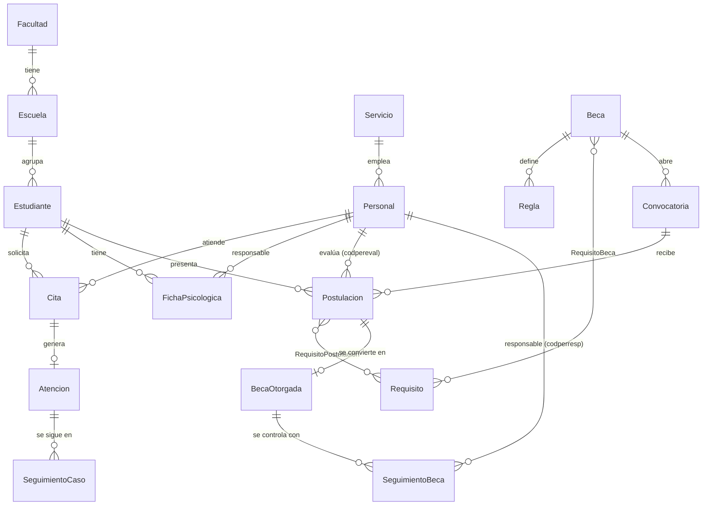

# Sistema de gestión de becas y bienestar universitario
**Proyecto Base de Datos 2 · Universidad de Huánuco**

Guía para exponer el proyecto: qué se construyó, cómo se relaciona y qué parte de lo visto en clase (vistas, procedimientos, funciones y triggers) usa cada pantalla.

## 1. Idea en una frase
La base de datos concentra las reglas y los cálculos; el backend (FastAPI) solo llama a esos objetos SQL y la web (HTML, Bootstrap y JavaScript) muestra el resultado. Todo el SQL vive en `database/` y se ejecuta en orden de `01tablas` a `06triggers` (`07pruebas` es el script de pruebas).

## 2. Modelo entidad-relación



Puntos para explicar:
- **18 tablas** en tres bloques: académico (Facultad, Escuela, Estudiante), becas y postulaciones, y bienestar.
- **Relaciones 1:1:** `Atencion.codcita` y `BecaOtorgada.codpost` son únicos, así una cita tiene una sola atención y una postulación una sola beca.
- **Relaciones N:M** resueltas con tabla intermedia: `RequisitoBeca` (qué requisitos pide cada beca) y `RequisitoPostulacion` (qué documentos presentó el postulante, con fecha, observación y estado).
- `Personal` cumple varios roles (evaluador, responsable de ficha, responsable de seguimiento) y se distingue por la columna: `codpereval` o `codperresp`.

## 3. Objetos SQL y dónde se usan

### Vistas
| Vista | Qué muestra | Pantalla |
|---|---|---|
| v01 | postulaciones por estudiante y año | Reportes de postulaciones |
| v02 | becas otorgadas por convocatoria | Reportes de becas |
| v03 | citas por profesional | Reportes de bienestar (gráfico) |
| v04 | casos de riesgo alto o crítico con seguimiento pendiente | Reportes de bienestar (tabla) |
| v05 | promedio de seguimiento por beca | Reportes de postulaciones |
| v06 | postulaciones y aprobadas por convocatoria | Reportes de becas |

### Procedimientos (devuelven un `mensaje` en lugar de lanzar error)
| Procedimiento | Qué hace | Pantalla |
|---|---|---|
| p01 | registra una postulación: valida estudiante, convocatoria abierta y en fechas, duplicado, promedio mínimo e ingreso familiar máximo de la beca | Postular |
| p02 | evalúa la postulación (puntaje, estado y evaluador) y no aprueba si ya no hay cupos | Postulaciones (admin) |
| p03 | otorga la beca a una postulación aprobada | Becas otorgadas |
| p04 | registra una cita solo si el profesional está libre | Citas y Mis citas |
| p05 | registra la atención y marca la cita como atendida | Citas y Atenciones |
| p06 | busca estudiantes por apellido | Buscar estudiantes |
| p07 | top 10 de becas con más postulaciones en un año | Reportes de becas |

### Funciones
| Función | Qué calcula | Pantalla |
|---|---|---|
| f1 | cantidad de postulaciones de un estudiante | Inicio y Mis postulaciones |
| f2 | promedio de seguimiento de una beca otorgada | Mis becas |
| f3 | edad del estudiante | Buscar estudiantes y Mi perfil |
| f4 | mensaje según el estado de la postulación | Mis postulaciones |
| f5 | nivel de vigilancia según sus atenciones de riesgo | Atenciones, Inicio y Seguimiento |
| f6 | cupos disponibles de una convocatoria | Catálogo de becas |

### Triggers (auditoría)
Cada tabla auditada tiene tres triggers (insertar, actualizar y eliminar) que escriben en su tabla de control con la fecha y el tipo de acción. En las actualizaciones se guarda `antes-después`.

| Tabla | Triggers | Tabla de control |
|---|---|---|
| postulacion | tr_insPostu, tr_upPostu, tr_delPostu | ctrl_postu |
| becaotorgada | tr_insOtor, tr_upOtor, tr_delOtor | ctrl_otor |
| cita | tr_insCita, tr_upCita, tr_delCita | ctrl_cita |

La pantalla **Auditoría** solo lee estas tablas; el backend nunca las escribe, solo los triggers.

## 4. Arquitectura del backend
```
router  →  service  →  repository  →  base de datos
HTTP       reglas       acceso a datos   tablas, vistas, procedimientos y funciones
```
- **Routers:** reciben la petición y devuelven la respuesta; no tienen lógica.
- **Services:** deciden qué hacer (por ejemplo, convertir el mensaje de un procedimiento en un error 404 o 409). Dependen de repositorios abstractos.
- **Repositories:** una clase abstracta (contrato) y su implementación con SQLAlchemy. Aquí viven las llamadas `call pNN`, `select * from vNN` y `func.fN`.
- **`dependencies.py`:** único lugar donde se conecta cada service con su repositorio concreto.
- **Schemas (Pydantic)** validan lo que entra y sale.

Cómo se ve **SOLID**:
- *S*: cada clase hace una cosa (el repositorio consulta, el service decide, el router responde).
- *O*: agregar un módulo nuevo (como Auditoría) no modifica los existentes; solo se registra en `main.py` y `dependencies.py`.
- *L* y *D*: los services reciben la abstracción del repositorio, por lo que se puede cambiar la base de datos o probar con un repositorio falso sin tocar las reglas.
- *I*: los contratos son pequeños y específicos de cada módulo.

## 5. Ejemplo de punta a punta: postular a una beca
1. El estudiante elige su perfil y la convocatoria en **Postular** y escribe su promedio e ingreso familiar.
2. El navegador envía `POST /api/postulaciones`.
3. El service llama al repositorio, que ejecuta `call p01(...)`.
4. p01 valida estudiante, convocatoria abierta y dentro de fechas, que no haya postulado antes y que el promedio cumpla la regla de la beca. Si algo falla responde un `mensaje`; si todo va bien inserta.
5. El trigger `tr_insPostu` registra el movimiento en `ctrl_postu`.
6. El service convierte el mensaje en éxito (201) o en error (404 si "no existe", 409 en los demás casos) y la pantalla muestra el aviso.
7. **Mis postulaciones** muestra el flujo de avance, el conteo con `f1` y el texto de estado con `f4`.

## 6. Reglas de negocio y quién las garantiza
| Regla | Dónde se valida |
|---|---|
| Una postulación por estudiante y convocatoria | p01 |
| Solo se postula con convocatoria abierta y en fechas | p01 |
| No se pasa del ingreso familiar máximo de la beca | p01 |
| No se aprueban más postulaciones que cupos | p02 |
| La postulación cumple las reglas de la beca | p01 |
| Un profesional no tiene dos citas a la misma hora | p04 |
| Solo se otorga beca a postulaciones aprobadas | p03 |
| Un solo registro de atención por cita | restricción única + p05 |
| La próxima sesión no es anterior al seguimiento | service de seguimiento de casos |
| Promedios entre 0 y 20, fecha fin no anterior a inicio | restricciones `check` y services |
| Ficha: diagnóstico y plan se completan después | solo fecha, motivo, estudiante y responsable son obligatorios |

## 7. Guion sugerido de demostración (8 a 10 minutos)
1. **Modelo** (2 min): mostrar el diagrama y nombrar los tres bloques y las dos tablas intermedias.
2. **Postulación** (3 min): Catálogo → Postular con un promedio bajo (el procedimiento rechaza) → con uno válido (queda registrada) → Mis postulaciones.
3. **Evaluación y beca** (1 min): en administración, evaluar y otorgar; mostrar que solo deja otorgar si está aprobada.
4. **Bienestar** (2 min): Mis citas → pedir una cita con un horario ocupado (p04 rechaza) → registrar la atención en Citas → Seguimiento muestra el nivel de vigilancia (f5).
5. **Triggers** (1 min): abrir **Auditoría** y mostrar los movimientos que acaban de quedar registrados, incluido el "antes → después".
6. **Reportes** (1 min): gráficos y tablas que salen directo de las vistas v01 a v06.

## 8. Preguntas probables y cómo responderlas
- **¿Por qué el SQL va en `database/` y no en el backend?** Porque las reglas y los cálculos pertenecen a la base de datos; el backend solo los invoca, así cualquier otro sistema obtiene el mismo resultado.
- **¿Por qué los procedimientos devuelven un mensaje y no un error?** Es el estilo visto en clase; el service traduce ese mensaje a un código HTTP.
- **¿Qué pasa si falla el procedimiento a la mitad?** El repositorio hace `rollback` y propaga el error.
- **¿El backend escribe en las tablas de auditoría?** No, solo las lee; las escriben los triggers.
- **¿Dónde está el login?** Se deja para el final como módulo `auth`; por ahora el estudiante se elige en un selector.

## 9. Cómo ejecutar
```
mysql -u root -p --default-character-set=utf8mb4 < database/01tablas.sql
(repetir con 02datosprueba, 03vistas, 04procedimientos, 05funciones, 06triggers y 08usuarios;
 07pruebas es opcional: muestra cada validación de los procedimientos)

cd backend
python crearusuarios.py
uvicorn app.main:app --reload
```
Luego se abre `http://localhost:8000` (el backend también sirve las pantallas) y se entra con `admin` / `admin123` o con el DNI de un estudiante.
El archivo `.env` usa las claves `DBHOST`, `DBPORT`, `DBUSER`, `DBPASSWORD` y `DBNAME`. La documentación interactiva de la API queda en `http://localhost:8000/docs`.

## 10. Acceso y roles
- La tabla `Usuario` (script `08usuarios.sql`) guarda el usuario, la contraseña cifrada y el rol: `ADMIN` o `ESTUDIANTE`. Un estudiante siempre apunta a su registro de `Estudiante`.
- `python crearusuarios.py` (desde `backend/`) crea `admin` / `admin123` y un usuario por estudiante: su DNI es el usuario y la contraseña inicial.
- El login devuelve un token firmado; el navegador lo envía en cada petición. Toda la API exige sesión, salvo el login.
- El administrador puede todo. El estudiante solo consulta los catálogos y gestiona lo suyo: sus postulaciones, citas, becas y seguimiento. Si pide datos de otro estudiante, la API responde 403.
- Las contraseñas se guardan con PBKDF2 y sal propia; nunca en texto plano.
- Cada usuario cambia su contraseña en **Mi perfil**. El estudiante tiene además un **Inicio** con su resumen (f1, f5) y avisos de sus trámites.
